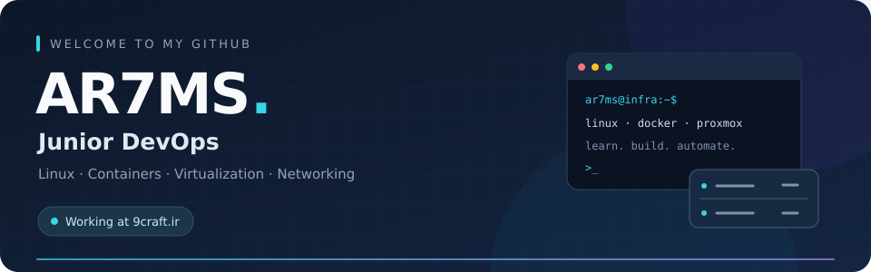
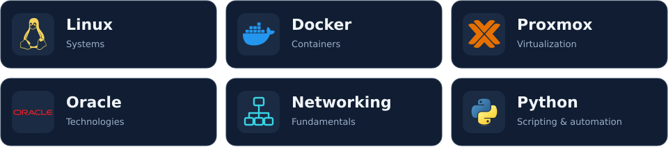

  

  <strong>Junior DevOps at <a href="https://9craft.ir">9craft.ir</a></strong> 
  Linux systems · Containers · Virtualization · Networking

## About me

Hi, I'm **AR7MS** 👋

I'm a **Junior DevOps** professional at **[9craft.ir](https://9craft.ir)**. My work centers on Linux, containers, virtualization, and networking. **Python** remains part of my toolkit for scripting and automation.

I enjoy understanding how systems work, troubleshooting problems, and making everyday operations easier to repeat.

## Skills & technologies

  

| Technology | My focus |
| :--- | :--- |
| **Linux** | System administration, services, and troubleshooting |
| **Docker** | Containers and application environments |
| **Proxmox** | Virtualization and virtual machine management |
| **Ansible** | Configuration management and infrastructure automation |
| **Networking** | Network fundamentals and connectivity troubleshooting |
| **Python** | Scripting and automating repetitive tasks |

## What I'm focused on

- Building practical experience with Linux infrastructure and container environments.
- Making operational tasks more repeatable through scripting and clear documentation.
- Growing my DevOps skills in **CI/CD**, **monitoring**, and **infrastructure automation**.

---

  <strong>Learn. Build. Automate.</strong> 
  Thanks for stopping by — explore my repositories below.

